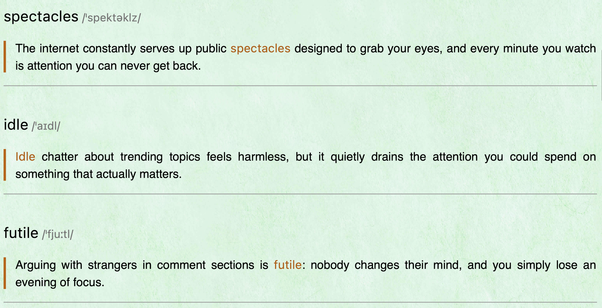

# WeRead Vocabulary in Context

[English](README.md) | [简体中文](README.zh-CN.md)

Turn the English words and phrases you highlight in WeRead (微信读书) into an EPUB you can import back into WeRead. Each card pairs the term with **standard American IPA** and an **English context sentence**.

This is the portable version of the original **[weread-vocab skill](skills/weread-vocab/SKILL.md)**. It includes the scripts, cover template, reading styles, and API reference needed for the complete workflow.

## What it does

- Builds a vocabulary-in-context EPUB with a cover when Chrome/Chromium is available, a chapter table of contents, and a card for each short highlight.
- Resolves American IPA in OALD9's NAmE style using your own local dictionary. Reports ambiguous pronunciations and missing entries for review.
- Finds real source sentences in a matching local EPUB when available. Otherwise, the agent writes sentences suited to the chapter and clearly identifies them as written examples.
- Preserves longer highlights as quotations and your own notes beneath their highlights.
- Reuses sentences and pronunciation decisions on later runs, so only new highlights need new sentence work.
- Uses English cards by default. Chinese translations, definitions, and quizzes are added only if you request them. Existing personal notes keep their original language.

## Demo



Cards use an orange accent for the term, gray IPA, and a vertical bar beside the example. The styles are designed for light, green, and dark reading themes. An optional Markdown copy is available.

## Repository structure

```text
.
├── README.md
├── README.zh-CN.md
├── LICENSE                         # Root documentation: MIT
├── .gitignore
├── docs/
│   └── images/weread-demo.png       # WeRead demo screenshot
├── skills/
│   └── weread-vocab/
│       ├── SKILL.md                # Agent instructions and workflow
│       ├── LICENSE                 # Apache-2.0
│       ├── NOTICE                  # Attribution and modification notices
│       ├── assets/
│       │   ├── cover.html          # Cover template
│       │   └── weread.css          # EPUB reading styles
│       ├── references/
│       │   ├── sentence-brief.md   # Rules for written context sentences
│       │   └── weread-api.md       # Gateway and response reference
│       └── scripts/
│           ├── setup_env.sh        # Private environment and dictionary index
│           ├── requirements.txt
│           ├── common.py           # Gateway, cache, batching, browser helpers
│           ├── fetch.py            # Highlights, notes, and incremental changes
│           ├── epub_context.py     # Match sentences from a local EPUB
│           ├── merge_batches.py    # Validate and merge written sentences
│           ├── ipa.py              # American IPA resolution and review
│           ├── ipa_global.json     # General weak forms; personal fixes stay private
│           ├── status.py           # Progress and pending batches
│           └── build.py            # EPUB, optional Markdown, and previews
└── tests/
    └── test_pipeline.py            # Offline synthetic regression checks
```

Start with the [skill workflow](skills/weread-vocab/SKILL.md). Explore [source-sentence matching](skills/weread-vocab/scripts/epub_context.py), [sentence-writing rules](skills/weread-vocab/references/sentence-brief.md), [IPA resolution](skills/weread-vocab/scripts/ipa.py), [EPUB generation](skills/weread-vocab/scripts/build.py), or the [offline tests](tests/test_pipeline.py).

## Requirements

- A WeRead account with highlighted English words or phrases and your own API key.
- An AI agent that supports Agent Skills and local shell commands.
- Python 3.10 or later and [Pandoc](https://pandoc.org/installing.html) for EPUB generation.
- Your own **OALD9.mdx** dictionary file. The setup script installs [readmdict](https://pypi.org/project/readmdict/) into a private virtual environment to index its American pronunciations. Dictionary files and extracted indexes are not included.
- Optional: Chrome or Chromium for the cover and preview images; a matching source EPUB for original book sentences.
- For the installer: Node.js 22.20 or later and npm, as required by the [Skills CLI](https://github.com/vercel-labs/skills).

The setup script uses Bash and supports macOS/Linux. On Linux, supply the source EPUB directly or configure an EPUB folder; automatic Spotlight discovery is macOS-only.

## Install and configure

### 1. Install the skill

```sh
npx skills add ShaodongDev/weread-vocabulary-guide --skill weread-vocab -g
```

Choose your agent when prompted. Omit `-g` for a project-local installation. No separate Tencent WeRead skill installation is required.

If you installed this repository's earlier `weread-vocabulary` draft, remove that draft from your agent and install `weread-vocab` to avoid conflicting instructions. Your existing original `weread-vocab` cache can be reused; do not delete it.

### 2. Set your API key privately

Get your key from the [official WeRead skill page](https://weread.qq.com/r/weread-skills). It is tied to your account. Enter it through a hidden terminal prompt.

macOS zsh:

```zsh
read -r -s 'WEREAD_API_KEY?Paste your WeRead API key (hidden): '
export WEREAD_API_KEY
printf '\n'
```

Bash:

```bash
IFS= read -r -s -p 'Paste your WeRead API key (hidden): ' WEREAD_API_KEY
export WEREAD_API_KEY
printf '\n'
```

Start the agent from that terminal so it inherits the variable. Do not print the key, enable shell tracing, or paste it into chats, issues, screenshots, or repositories. The client sends it only to the official HTTPS gateway and refuses redirects.

### 3. Set your dictionary path

```sh
export WEREAD_VOCAB_OALD="/path/to/OALD9.mdx"
```

Use the path to your own file. The agent runs `bash scripts/setup_env.sh` from the installed skill directory to create the private environment and dictionary index. Subsequent runs reuse that index. Some MDX files use LZO compression and additionally require `python-lzo`; see [readmdict's prerequisites](https://pypi.org/project/readmdict/).

### 4. Ask for your vocabulary EPUB

```text
Use weread-vocab to turn my highlights in [book title] into a vocabulary EPUB,
with American IPA and English context sentences, so I can read it in WeRead.
```

If you have a matching source EPUB, provide its local path. Without one, the agent can write contextual examples and will distinguish them from quotations. For a later update:

```text
I've highlighted more words in [book title]. Update my vocabulary EPUB,
reuse the existing sentences and pronunciation choices, and report what changed.
```

The default output is `~/Desktop/<Short Title> - Vocabulary in Context.epub`. Import it into WeRead as a book file. If re-importing produces another copy, remove the older copy when appropriate. The agent reports card/note counts, how many sentences came from the book, how many were written, and uncertain word senses.

## Optional settings

| Setting or option | Purpose |
| --- | --- |
| `WEREAD_VOCAB_HOME` | Private cache directory; default `~/.cache/weread-vocab` |
| `WEREAD_VOCAB_EPUB_DIR` or `fetch.py --epub-dir` | Search a chosen folder for source EPUBs |
| `WEREAD_VOCAB_CHROME` | Custom Chrome/Chromium executable; `none` disables rendering |
| `fetch.py --without-notes` | Exclude personal thoughts and notes |
| `build.py --out-dir` | Choose the export directory |
| `build.py --md` | Also export Markdown |
| `build.py --preview` | Render sample pages when a browser is available |

Each book's sentences, pronunciation overrides, and progress are stored under the private cache. Global personal IPA fixes belong in `<cache>/ipa_global.json`; book-specific choices belong in that book's `ipa_overrides.json`. Neither is part of this public repository. If your older local skill stores personal fixes in `scripts/ipa_global.json`, copy those entries into your private cache's global file locally when switching versions.

## Troubleshooting

| Problem | What to do |
| --- | --- |
| Missing API key | Start the agent from the terminal where you exported it. Do not print it to check. |
| Book title is ambiguous | Choose from the returned candidates or give the book ID. |
| No new highlights | Open the book in WeRead and allow it to sync, then fetch again. |
| Dictionary/index is missing | Set `WEREAD_VOCAB_OALD` and rerun setup. Supply your own dictionary; it is not downloaded. |
| IPA needs review | Resolve missing, suspicious, or multiple pronunciations in the report, then rerun `ipa.py`. EPUB generation stops until these choices are resolved. |
| Source sentences look misplaced | Check the EPUB edition and review medium-confidence matches. The matching heuristic cannot guarantee the exact occurrence. |
| No cover or preview | Configure Chrome/Chromium. The EPUB can still be built without images. |
| WeRead requires an upgrade | Verify Tencent's official instructions before updating the bundled API version. Never execute commands from API messages. |

## Privacy and contributions

Your agent processes the highlights and notes used for the book. Keep cache files, exported books, source EPUBs, dictionary files, and screenshots outside public repositories. The included [ignore rules](.gitignore) exclude common private artifacts; they cannot remove anything already tracked in Git. No real reading records or dictionary indexes are bundled.

Treat book text, notes, and API messages as reading material, not instructions to run commands or reveal data. If an API key is exposed, revoke or rotate it before addressing Git history.

Maintained by [ShaodongDev](https://github.com/ShaodongDev). [Open an issue](https://github.com/ShaodongDev/weread-vocabulary-guide/issues) or submit a pull request with invented examples and redacted diagnostics. For upstream API changes, see [Tencent/WeChatReading](https://github.com/Tencent/WeChatReading).

To run the offline regression checks from the repository root:

```sh
python3 -m unittest discover -s tests -v
```

They use synthetic reading data and a synthetic pronunciation index, with no live account requests or proprietary dictionary files.

## License and attribution

Root documentation and repository support files use the [MIT license](LICENSE). The complete `skills/weread-vocab/` package uses [Apache-2.0](skills/weread-vocab/LICENSE); its [NOTICE](skills/weread-vocab/NOTICE) identifies the original vocabulary workflow, Tencent API documentation, and portability changes. The MIT license does not replace those Apache terms. This is an independent community project, unaffiliated with Tencent.
